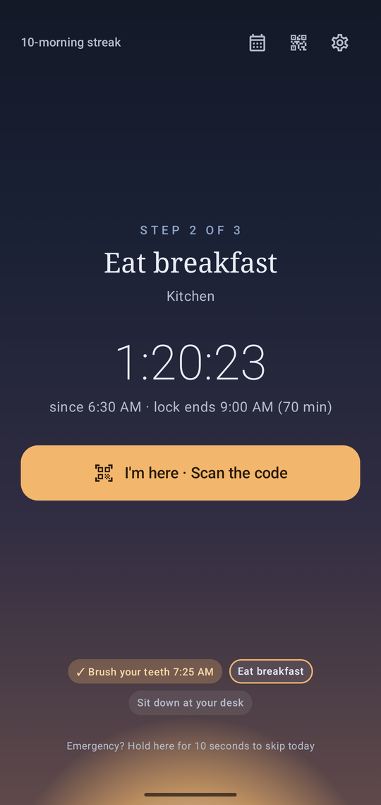
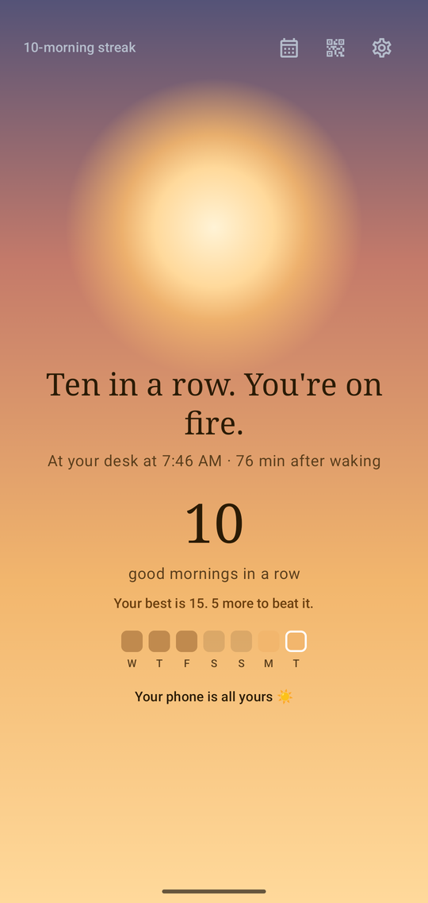
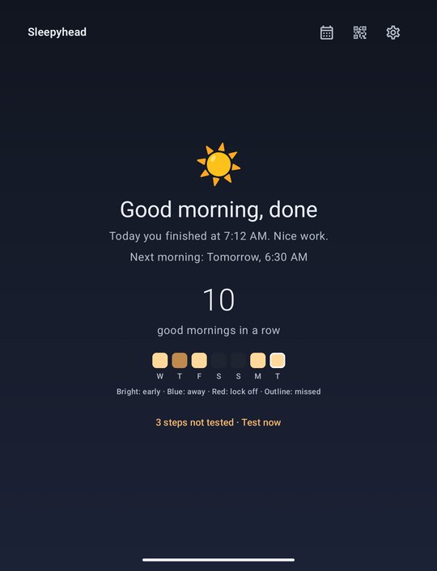
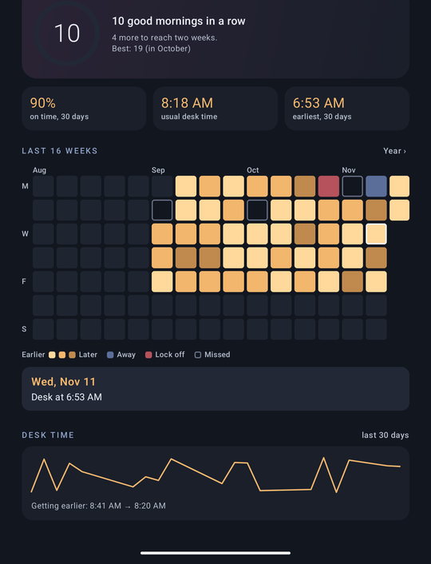
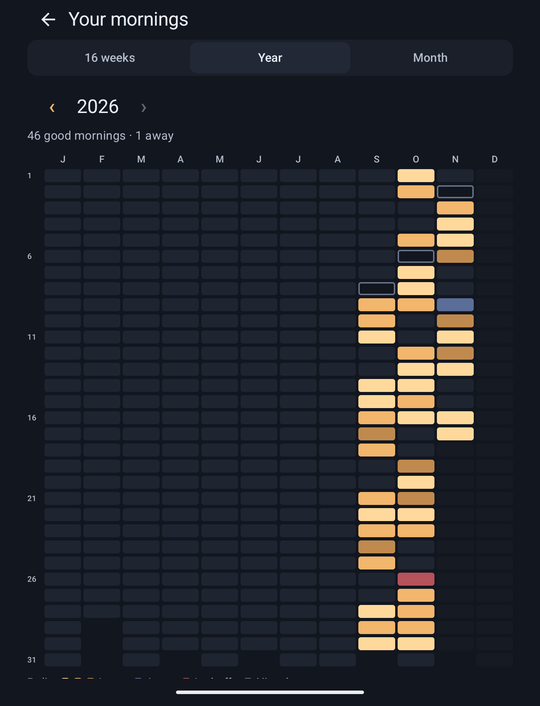
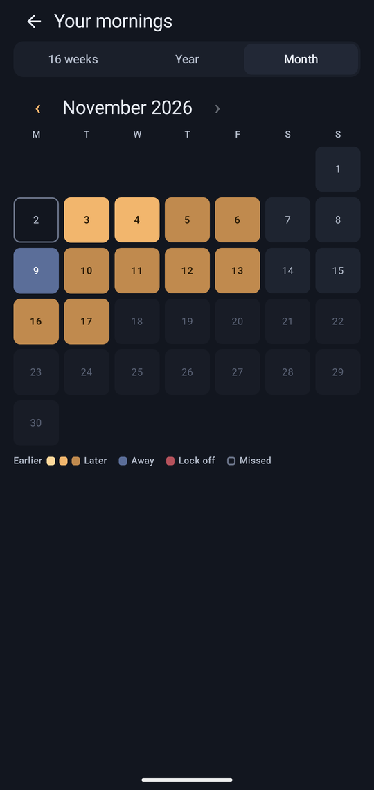

<p align="center"></p>

<h1 align="center">Sleepyhead</h1>

Sleepyhead is an Android app that helps you get out of bed and to your desk in the morning,
instead of reading news, social media and work chat in bed.

## Screenshots

| During the lock | Routine done | Outside the lock |
| :---: | :---: | :---: |
|  |  |  |
| The next step, the time since lock start and the time to lock end. | The sun is up. The screen shows your streak and your last 7 days. | The screen shows your result for today and your next lock start. |

| History: 16 weeks | History: Year | History: Month |
| :---: | :---: | :---: |
|  |  |  |
| Your streak, your stats and one square for each morning. Tap a square to see that day. | One square for each morning of the year. | One square for each morning of the month. |

The screenshots use test data on an Android emulator.

## What it does

- **Onboarding.** The first launch walks you through the lock times, the apps to block,
  your steps, the permissions, travel mode and printing the QR codes.
- **Morning lock.** From lock start (your wake-up time), the apps you choose (news, social, work chat) are blocked.
  When you open one, Sleepyhead sends you back to its calm screen. The lock stops when you finish
  your routine, or at lock end.
- **Proof-based checklist.** Each step of your routine has a printed QR code, an NFC tag, or both, in its place:
  bathroom, kitchen, desk. You finish a step only when you scan its code or tap its tag. You must do the steps in order.
- **Calm start screen.** During the lock, the screen shows only the next step, a timer since lock start,
  and the time left until lock end. Outside the lock, it shows when your next morning starts,
  your streak and the last 7 days.
- **The sky.** During the lock, the Home background moves from night to dawn with each step, and a sun rises.
  A row of chips shows your steps and the time you did each one. When you finish, the sky is a full sunrise.
- **Streaks and history.** A morning counts when you finish before lock end. History shows a streak ring
  that fills toward the next milestone, your on-time rate, your usual desk time and your average time from
  lock start to desk. A 16-week grid, a Year in pixels view and a Month view show one square per morning:
  an earlier finish is brighter. Tap a square to see the day (desk time, minutes, blocked-app attempts).
  A chart shows your time to desk for the last 30 days.
- **Travel mode.** Save your home location once. At lock start, if your phone is away from home,
  the lock stays off for that day. Travel days do not break your streak. There is no manual
  "lock off" switch, so travel mode is not an easy way out.
- **Honest streaks.** A morning counts only when the lock was on for the whole lock window.
  If the lock service stops during the lock (for example after *Force stop*), that morning shows
  "Lock was off" and does not count. Time while the phone is switched off does not count as a gap.
  During the lock, a red card on the calm screen tells you when the lock is off and turns it back on.
- **Settings guard.** During the lock only, Sleepyhead sends you back when you open its own
  *App info* page (Force stop, Uninstall), its *Storage* page (Clear storage), its Accessibility page,
  or its uninstall dialog. It finds these pages by their text plus the app name, so the app list
  and other apps' pages stay open. Outside the lock, nothing in Settings is blocked.
- **Emergency skip.** Hold the text at the bottom of the calm screen for 10 seconds to unlock for the day.
  A skipped day breaks the streak.

Default routine (you can edit it in Settings → Steps):

1. Brush your teeth (Bathroom)
2. Eat breakfast (Kitchen)
3. Sit down at your desk (Home office desk)

Default times: lock starts 6:30, lock ends 9:00, Monday to Friday.

## Build

Requirements: JDK 17 or newer and the Android SDK (platform 35). Android Studio has both.

```sh
./gradlew assembleDebug        # APK: app/build/outputs/apk/debug/app-debug.apk
./gradlew testDebugUnitTest    # unit tests for the routine and streak rules
./gradlew installDebug         # install on a connected phone (USB debugging on)
```

## Setup on the phone

1. Install the APK.
2. Open Sleepyhead → Settings (gear icon).
3. **Morning lock:** tap *Turn on*. In Accessibility, open *Sleepyhead morning lock* and turn it on.
   - On Android 13 and newer, a sideloaded app can show **"Restricted setting"**.
     Open *App info* for Sleepyhead (there is a button in Settings), tap the **⋮** menu,
     choose **Allow restricted settings**, then turn on the service again.
   - The service checks which app is in front. During the lock only, it also reads text in Settings and
     the package installer, to protect Sleepyhead's own pages. It does not read other apps.
4. **Camera:** tap *Allow*. The camera is used only to scan your codes.
5. **Blocked apps:** check the list. Sleepyhead selects common news, social and chat apps
   that are installed (for example X, Instagram, Reddit, Slack, Teams, Gmail, YouTube).
6. Set your lock start, lock end and days.
7. Optional: in Settings → Travel, allow location ("Allow all the time"), tap *Set to here* while you are at home,
   and check that *Turn off the lock when I'm away* is on (saving home the first time turns it on). Anywhere within 2 km of home counts as home.

The first launch shows these steps as onboarding. Settings → *Show the welcome steps again* shows them again.

## NFC tags

1. Settings → Steps → *Pair NFC tag* on a step.
2. Hold your phone to the tag. Sleepyhead saves the tag ID. If the tag is writable (for example NTAG213 stickers),
   it also writes a Sleepyhead record to it, so a tap opens Sleepyhead and finishes the step even when the app is closed.
3. Stick the tag in that place. A read-only tag works too, but open Sleepyhead before you tap it.

## Print the QR codes

1. Tap the QR icon on the home screen.
2. Tap **Print or save as PDF**. You get one page per step. You can also save a PDF and print it later.
3. Tape each code in its place. Put the bathroom code where you cannot scan it from bed.

Each install makes its own random codes. If you reinstall the app, or tap *Make new QR codes*
in Settings → Steps, print the codes again.

## Test your codes

Settings → Steps → **Test** on each step. Scan the step's QR code or tap its NFC tag. Sleepyhead confirms
that it is the right code, and it marks the step "Tested". A test never counts as doing the step.
Outside the lock window, a scan on Home also never counts, so you cannot finish tomorrow's routine tonight.

## Try it now

Set the lock start to a few minutes ago, then open a blocked app. Sleepyhead opens instead.
Scan the codes in order. *Settings → Clear today's progress* resets today.

## Limits

- You can change the routine and blocked apps only when the lock is off.
  During the lock, Sleepyhead's own settings pages are blocked. A restart of the phone into safe mode, or
  `adb`, can still stop the lock. Then that morning shows "Lock was off" and does not count.
- The morning window must be within one day (lock start before lock end).
- Data stays on the phone (SharedPreferences). There is no account and no network use.
- If Sleepyhead cannot get your location at lock start, the lock stays on.

## Code map

| Path | What it holds |
| --- | --- |
| `data/Routine.kt` | Pure rules: lock window, step order, on-time, streaks (unit tested) |
| `data/Insights.kt` | Pure numbers for History: square colours, stats, milestones, trend (unit tested) |
| `data/Store.kt` | Saves settings, steps and the daily log as JSON |
| `lock/LockService.kt` | Accessibility service that sends you back from blocked apps and guarded pages |
| `lock/SettingsGuard.kt` | Finds Sleepyhead's App info, Storage, Accessibility and uninstall pages |
| `lock/LockHealth.kt` | Finds gaps when the lock service was off, for honest streaks |
| `nfc/Nfc.kt` | NFC reader mode, tag pairing and writing, and tags that open the app |
| `travel/TravelCheck.kt` | Home/away check at lock start, and the lock-start alarm |
| `qr/QrCodes.kt` | QR generation and the print/PDF document |
| `ui/Sky.kt`, `ui/History.kt` | The sky behind Home, the palette, and the History grids |
| `ui/` | Jetpack Compose screens: onboarding, home, settings, blocked apps, steps, codes, history |
